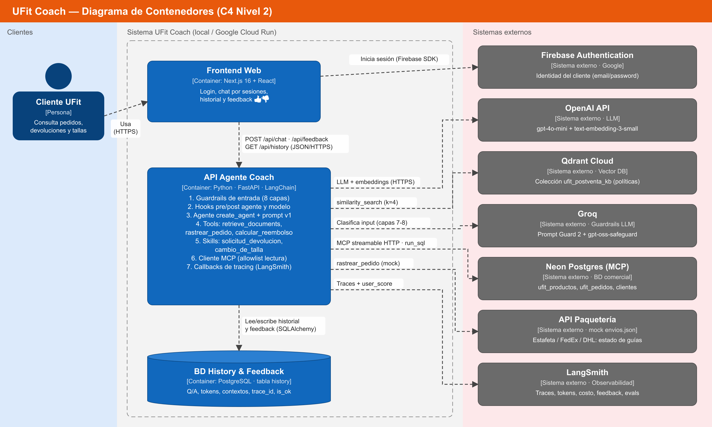
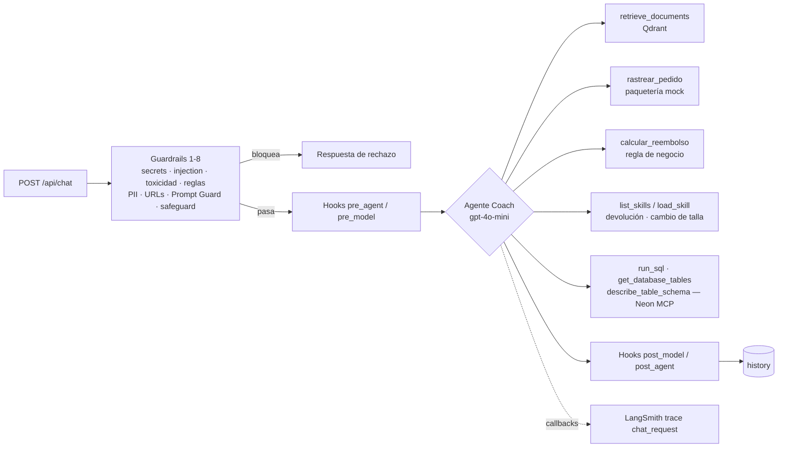
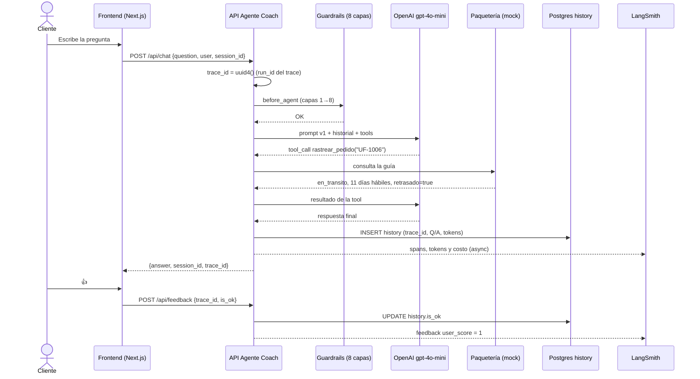

# Arquitectura — UFit Coach

## C4 Nivel 2 — Diagrama de contenedores

| Elemento | Tipo | Tecnología | Responsabilidad |
|---|---|---|---|
| Cliente UFit | Persona | Navegador | Consulta pedidos, devoluciones, tallas y garantías |
| Frontend Web | Container | Next.js + React + Firebase SDK | Login, chat por sesiones, historial y feedback 👍/👎 |
| API Agente Coach | Container | Python, FastAPI, LangChain `create_agent` | Guardrails, hooks, agente, tools, skills, cliente MCP, tracing |
| BD History & Feedback | Container | PostgreSQL (tabla `history`) | Historial de Q/A, tokens, contextos recuperados, `trace_id`, `is_ok` |
| Firebase Authentication | Externo | Google | Identidad del cliente |
| OpenAI | Externo | `gpt-4o-mini`, `text-embedding-3-small` | Razonamiento del agente y embeddings |
| Qdrant Cloud | Externo | Vector DB | Colección `ufit_postventa_kb` con las políticas de UFit |
| Groq | Externo | Llama Prompt Guard 2, gpt-oss-safeguard | Guardrails de entrada, capas 7 y 8 (fail-close) |
| Neon Postgres (MCP) | Externo | Neon MCP, streamable HTTP | BD comercial: `ufit_productos`, `ufit_pedidos`, `ufit_detalle_pedidos`, `ufit_clientes` |
| API Paquetería | Externo (mock) | `backend/data/envios.json` | Estado de guías de Estafeta, FedEx y DHL |
| LangSmith | Externo | LangSmith SDK | Traces, tokens, costo, feedback `user_score` y evals |

## Componentes dentro de la API Agente Coach

## Secuencia: "¿Dónde está mi pedido UF-1006?"

## Decisiones de diseño

1. **Reutilizar la arquitectura del curso.** El BE `06_agent_llmops_obs` y el FE `02_agent_app_feedback` se usan sin cambios estructurales. Solo cambian el dominio (KB, data, tools, skills y prompt) y la marca.
2. **Cálculos deterministas en tools.** El reembolso (`calcular_reembolso`) y el retraso de un envío (`retrasado` en `rastrear_pedido`) se calculan en código, no los razona el LLM. Así son exactos y auditables.
3. **Mínimo privilegio en MCP.** El MCP de Neon expone más de 100 tools (`delete_project`, `create_branch`, …). El agente solo recibe `run_sql`, `get_database_tables` y `describe_table_schema` (`NEON_ALLOWED_TOOLS` en `tools.py`).
4. **Fail-close en guardrails LLM.** Si Groq no responde dentro de `GROQ_TIMEOUT_SECONDS`, el mensaje se bloquea. En la prueba, el free tier de Groq tuvo picos de unos 20 s, así que el timeout pasó de 3 s a 10 s. Es un trade-off explícito entre seguridad y disponibilidad.
5. **Un mismo `trace_id`** en la respuesta de la API, en la tabla `history` y en LangSmith, para conectar el feedback humano con el trace.
